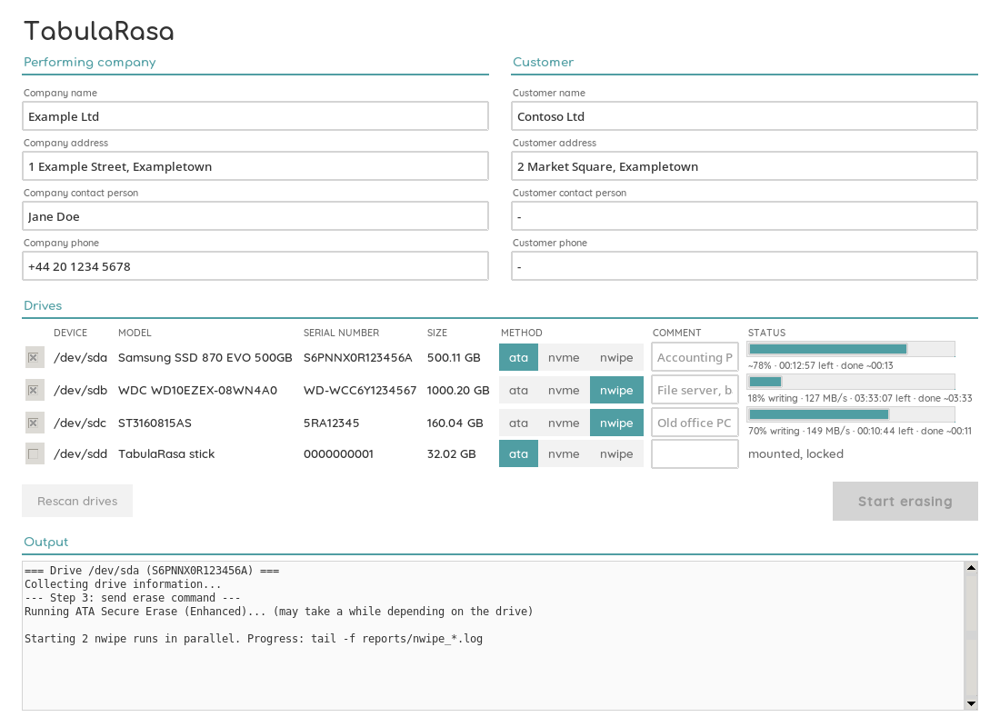
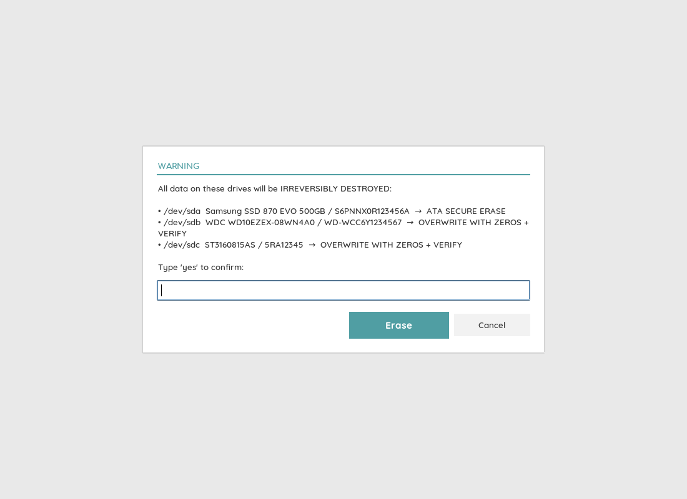
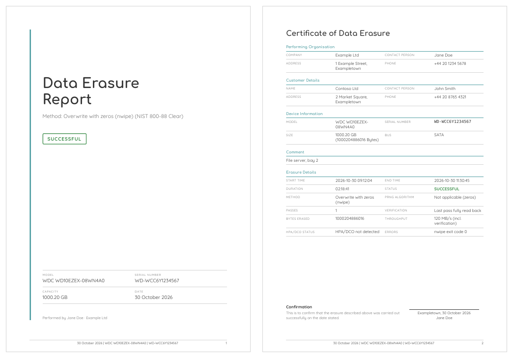

# TabulaRasa

Erases HDDs, SATA SSDs and NVMe SSDs and writes one PDF report per drive (cover page, certificate, appendices with SMART data, a hexdump spot check and the tool logs). Reports are available in German and English.

| Drive | Method | NIST 800-88 |
|---|---|---|
| HDD | `nwipe`: 1 pass of zeros + verification | Clear |
| SATA SSD | ATA Secure Erase (Enhanced if supported) | Purge |
| NVMe SSD | `nvme format --ses=1` | Purge |

Several drives can be erased in one run, each with its own comment and report. ATA/NVMe drives run one after another, several nwipe runs in parallel. Frozen ATA drives are handled via standby (S3) or by asking you to replug the drive.

## Screenshots

Erasing three drives at once: ATA Secure Erase with the vendor's time estimate, two nwipe runs with measured progress. The boot stick itself is locked.



Nothing is erased without typing `yes`:



The report (cover page and certificate, here in English; appendices with SMART data, hexdump and logs follow):



*Screenshots with example data. Add your own `logo.png` and `signature.png` to show your logo and signature.*

## Setup

```sh
sudo apt install smartmontools hdparm nwipe nvme-cli bsdextrautils python3-venv python3-tk imagemagick fonts-comfortaa fonts-quicksand
python3 -m venv .venv
.venv/bin/pip install -r requirements.txt
sudo .venv/bin/python -m playwright install --with-deps chromium
cp config.example.toml config.toml
```

Requires Python 3.11 or newer and a 64-bit system.

## Data folder

Everything company-specific lives in one folder: by default next to `erase.py`, on the live stick on the REPORTS partition (environment variable `ERASE_HOME`):

| File | Content | If missing |
|---|---|---|
| `config.toml` | report language, company defaults, place, keyboard layout (template: `config.example.toml`) | German report, empty fields |
| `logo.png` | logo for report and window | no logo |
| `signature.png` | signature on the certificate | no signature |
| `reports/` | generated reports and nwipe logs | created automatically |

The window scales the logo with ImageMagick; without it the logo looks pixelated.

## Usage

```sh
sudo .venv/bin/python gui.py     # window
sudo .venv/bin/python erase.py   # terminal
```

If the window does not open on Wayland (`Cannot open a window`), run `xhost +SI:localuser:root` once as your normal user.

One report per drive: `erase_report_<serial>_<timestamp>.pdf` (+ `.html`, for nwipe also the log) in `reports/` of the data folder. With several parallel nwipe runs, follow the progress with `tail -f reports/nwipe_*.log` (the window shows progress and time left per drive).

## Live stick

Bootable USB stick (Debian 13, 64-bit) that starts straight into the window (kiosk with Cage, no desktop). Boots with BIOS, UEFI and Secure Boot.

Download the ISO from the [releases](https://github.com/undone37/TabulaRasa/releases) (check it with `sha256sum -c tabularasa-*.iso.sha256`) or build it yourself, then write the stick:

```sh
sudo apt install live-build
sudo live/build.sh                                               # -> live/tabularasa.iso
sudo live/make-stick.sh live/tabularasa.iso /dev/sdX             # new stick, erases EVERYTHING on it
sudo live/make-stick.sh --update live/tabularasa.iso /dev/sdX    # only renew the system
```

`make-stick.sh` needs `exfatprogs` and `fdisk` (for `sfdisk`). CI builds the ISO on every relevant push to `main` (download under Actions → ISO → artifacts) and attaches it to a release for every `v*` tag.

From 4 GiB on, the stick gets an exFAT partition `REPORTS` (readable on Windows/macOS). It is the data folder; `make-stick.sh` copies your `config.toml`, `logo.png` and `signature.png` onto it. `--update` only overwrites the area before it. If an update is interrupted, the stick only boots again after another update, but the reports are kept.

On the stick the hardware clock is treated as local time (as on Windows machines) and the time zone is Europe/Berlin; change `timezone=` in `live/auto/config` before building for another one. Power off via the button in the window or the power button.

## Tests

```sh
.venv/bin/python -m unittest -v
```

## License

GPL-3.0, see [LICENSE](LICENSE).
